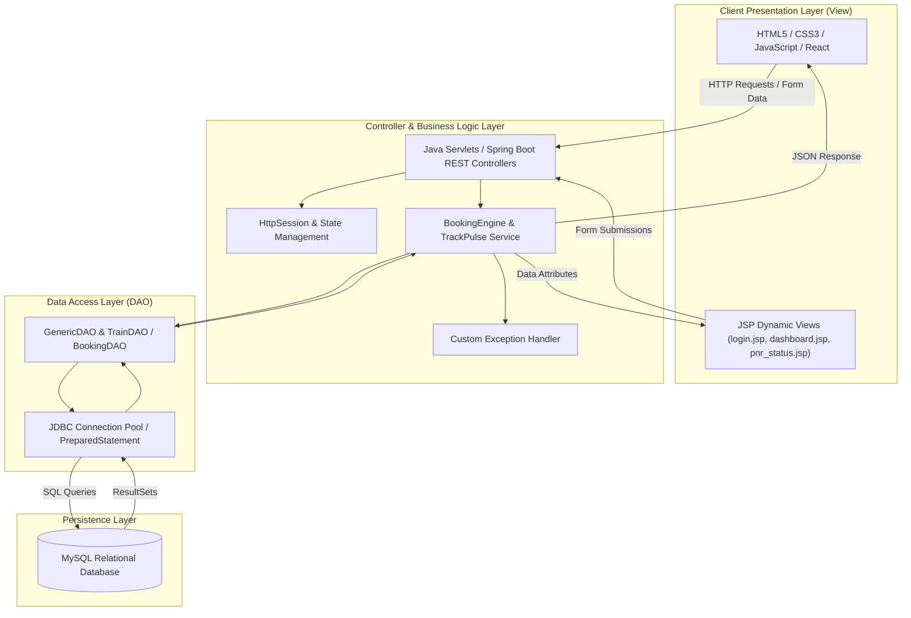

# 🚆 RailRush (TrackPulse)

> **Next-Generation Railway Ticket Reservation & Real-Time Train Tracking System**  
> *A Comprehensive Full-Stack Java (FSJ) Engineering Mini-Project*

[](https://aaryachavan076-gif.github.io/Project-Title-RailRush-or-TrackPulse-/)
[](https://github.com/aaryachavan076-gif/Project-Title-RailRush-or-TrackPulse-)
[](https://www.oracle.com/java/)
[](https://jakarta.ee/)
[](https://spring.io/projects/spring-boot)
[](https://www.mysql.com/)
[](LICENSE)

---

## 🌐 Live Website & Access

The live web application is hosted publicly via **GitHub Pages**:
- 🔗 **Live Website URL**: **[https://aaryachavan076-gif.github.io/Project-Title-RailRush-or-TrackPulse-/](https://aaryachavan076-gif.github.io/Project-Title-RailRush-or-TrackPulse-/)**
- 🧪 **FSJ Lab Suite (Exp 01 - 13)**: **[Lab Experiments Portal](https://aaryachavan076-gif.github.io/Project-Title-RailRush-or-TrackPulse-/experiments.html)**
- ⚛️ **Dedicated React SPA**: **[RailRush Single Page App](https://aaryachavan076-gif.github.io/Project-Title-RailRush-or-TrackPulse-/spa.html)**
- 📡 **TrackPulse Telemetry**: **[Live Train Tracker](https://aaryachavan076-gif.github.io/Project-Title-RailRush-or-TrackPulse-/track_pulse.html)**

### ⚡ Running Live Locally (One-Click)
Double-click `start_live_website.bat` or run:
```bash
python -m http.server 5000
```
Then visit **`http://localhost:5000/index.html`** in your browser.

---

## 📌 Table of Contents

- [Overview](#-overview)
- [Key Features](#-key-features)
- [Academic Curriculum Alignment](#-academic-curriculum-alignment-fsj-lab)
- [System Architecture](#-system-architecture)
- [Database Design](#-database-design-er--schema)
- [Project Directory Structure](#-project-directory-structure)
- [Technology Stack](#-technology-stack)
- [Getting Started](#-getting-started)
  - [Prerequisites](#prerequisites)
  - [Database Configuration](#database-configuration)
  - [Running on Eclipse / Tomcat](#running-on-eclipse--apache-tomcat)
- [Application Workflow & Use Cases](#-application-workflow--use-cases)
- [Future Roadmap](#-future-roadmap)
- [Author & Acknowledgments](#-author--acknowledgments)

---

## 📖 Overview

**RailRush (TrackPulse)** is a comprehensive railway ticketing and fleet tracking web application engineered to solve critical bottlenecks in railway reservation and journey monitoring. Drawing inspiration from modern transit portals such as **IRCTC**, the system bridges the gap between high-volume passenger ticket booking and real-time train movement telemetry.

Built using enterprise-grade **Java (OOP, Servlets, JSP, JDBC, and Spring Boot)** with a responsive web front-end, RailRush guarantees ACID-compliant transactions, role-based access control, automated PNR generation, and seamless schedule monitoring.

---

## ✨ Key Features

### 🎫 Passenger Portal (RailRush)
- **Train Search & Schedule Inquiry**: Query trains between source and destination stations filtered by date, class (1AC, 2AC, 3AC, Sleeper), and quota (General / Tatkal).
- **Seat Availability & Dynamic Booking**: Real-time quota validation to avoid overbooking.
- **PNR Generation & Status Tracking**: Unique 10-digit PNR tracking with real-time status (`CONFIRMED`, `RAC`, `WAITLISTED`, `CANCELLED`).
- **Cancellation & Refund Computation**: Automatic calculation of refund deductions and inventory recovery.
- **User Dashboard & Journey History**: Clean interface displaying past journeys, active e-tickets, and profile preferences.

### 🧭 Live Train Telemetry (TrackPulse)
- **Real-Time Station Timings**: Live lookup of scheduled vs. estimated arrival/departure times.
- **Platform Allocation Indicator**: Live platform numbers for terminal and intermediate stations.
- **Delay Analytics**: Status indicators showing on-time performance and estimated delay in minutes.

### 🛡️ Administration & Operations
- **Fleet & Route Management**: Admin privileges to add new trains, manage stops, configure coach layouts, and set distance-based tariffs.
- **Quota & Inventory Control**: Regulate Tatkal and General ticket allocations per coach.
- **Audit Logs & Passenger Manifests**: Generate chart status and passenger lists prior to departure.

---

## 🎓 Academic Curriculum Alignment (FSJ Lab)

**RailRush (TrackPulse)** is purposely structured to demonstrate every single laboratory experiment in the Full-Stack Java curriculum:

| Exp No. | Laboratory Syllabus Topic | Concrete Implementation in RailRush |
| :---: | :--- | :--- |
| **01** | **Programs on classes and objects** | Encapsulated domain entities: [`Train.java`](src/main/java/com/railrush/model/Train.java), [`User.java`](src/main/java/com/railrush/model/User.java), [`Passenger.java`](src/main/java/com/railrush/model/Passenger.java), and [`Ticket.java`](src/main/java/com/railrush/model/Ticket.java) with private fields and getter/setter methods. |
| **02** | **Programs on method and constructor overloading** | Overloaded constructors in [`Train.java`](src/main/java/com/railrush/model/Train.java) (lightweight lookup vs full route model); overloaded search signatures in [`TrainDAO.java`](src/main/java/com/railrush/dao/TrainDAO.java). |
| **03** | **Programs on various types of inheritance and Exception handling** | Class hierarchy ([`User.java`](src/main/java/com/railrush/model/User.java) $\rightarrow$ [`PassengerUser.java`](src/main/java/com/railrush/model/PassengerUser.java), [`AdminUser.java`](src/main/java/com/railrush/model/AdminUser.java)); Custom robust exceptions: [`SeatUnavailableException.java`](src/main/java/com/railrush/exception/SeatUnavailableException.java), [`InvalidPNRException.java`](src/main/java/com/railrush/exception/InvalidPNRException.java), and [`BookingFailedException.java`](src/main/java/com/railrush/exception/BookingFailedException.java). |
| **04** | **Program on Implementing Generic and HTTP servlet** | Protocol-independent [`GenericRailStatusServlet.java`](src/main/java/com/railrush/servlet/GenericRailStatusServlet.java) implementing `GenericServlet.service()`; production `HttpServlet` subclasses ([`LoginServlet.java`](src/main/java/com/railrush/servlet/LoginServlet.java), [`BookTicketServlet.java`](src/main/java/com/railrush/servlet/BookTicketServlet.java), [`TrackPulseServlet.java`](src/main/java/com/railrush/servlet/TrackPulseServlet.java)) handling `doGet()` and `doPost()`. |
| **05** | **Design a login webpage in JSP that makes validation through Database using JDBC and call the servlet for various operations** | Secure [`login.jsp`](src/main/webapp/login.jsp) authenticating against MySQL database using `PreparedStatement` in [`LoginServlet.java`](src/main/java/com/railrush/servlet/LoginServlet.java) and [`DBConnection.java`](src/main/java/com/railrush/dao/DBConnection.java). |
| **06** | **Program on Implicit and Explicit objects in JSP** | Session state and output via implicit objects (`session`, `request`, `out`, `application`) in [`dashboard.jsp`](src/main/webapp/dashboard.jsp); standard action tags `<jsp:useBean>` and `<jsp:getProperty>` in [`ticket_confirmation.jsp`](src/main/webapp/ticket_confirmation.jsp). |
| **07** | **Program to create a website using HTML CSS and JavaScript** | Modern responsive railway web portal ([`index.jsp`](src/main/webapp/index.jsp), [`css/style.css`](src/main/webapp/css/style.css), [`js/validation.js`](src/main/webapp/js/validation.js)) featuring responsive grid cards and navigation. |
| **08** | **Program using JavaScript to validate email address ('@' & '.' character check with alert dialog)** | Dedicated email character validation ([`js/exp08_email_validation.js`](src/main/webapp/js/exp08_email_validation.js)) verifying mandatory presence of `'@'` and `'.'`. Triggers alert error dialog and refocuses input for re-entry. |
| **09** | **Program based on Document Object Model to change background color automatically after every 5 seconds** | Real-time DOM color cycle module ([`js/exp09_dom_color.js`](src/main/webapp/js/exp09_dom_color.js)) switching railway station background palettes every 5000ms using `setInterval()` with live countdown timer. |
| **10** | **Program for making use of React Hooks displaying four buttons ("Red", "Blue", "Green", "Yellow")** | Interactive React functional component ([`js/exp10_react_color_hooks.js`](src/main/webapp/js/exp10_react_color_hooks.js)) using `useState` hook to render 4 color buttons and dynamically display: *"You have selected that particular color: [Color]"*. |
| **11** | **Creating a Single Page website using concepts in React (Hooks, Router, Props, States)** | Full client-side Single Page Application ([`spa.jsp`](src/main/webapp/spa.jsp), [`js/exp11_react_spa.js`](src/main/webapp/js/exp11_react_spa.js)) integrating client-side routing, React Hooks, Props passing, and State management for train search, live telemetry, and booking. |
| **12** | **Program to create a Monolithic Application using SpringBoot** | Monolithic server architecture ([`RailRushSpringBootApplication.java`](src/main/java/com/railrush/springboot/RailRushSpringBootApplication.java), [`RailRushMonolithController.java`](src/main/java/com/railrush/springboot/controller/RailRushMonolithController.java)) managing MVC templates, Dependency Injection, and unified services. |
| **13** | **Program for Building RESTful APIs with spring boot** | Production headless REST controller ([`RailRushRestController.java`](src/main/java/com/railrush/springboot/controller/RailRushRestController.java)) exposing `/api/v1/trains`, `/api/v1/bookings`, `/api/v1/pnr/{id}`, and `/api/v1/telemetry/{id}` with JSON serialization. |

---

## 🏗️ System Architecture

The application adopts a decoupled **3-Tier Model-View-Controller (MVC)** architectural standard:



---

## 🗄️ Database Design (ER & Schema)

### Relational Schema (`schema.sql`)

```sql
-- Database Initialization
CREATE DATABASE IF NOT EXISTS railrush_db;
USE railrush_db;

-- 1. Users Table (Role-Based Access)
CREATE TABLE IF NOT EXISTS users (
    user_id INT AUTO_INCREMENT PRIMARY KEY,
    full_name VARCHAR(100) NOT NULL,
    email VARCHAR(100) NOT NULL UNIQUE,
    password_hash VARCHAR(255) NOT NULL,
    role ENUM('PASSENGER', 'ADMIN') DEFAULT 'PASSENGER',
    phone_number VARCHAR(15),
    created_at TIMESTAMP DEFAULT CURRENT_TIMESTAMP
);

-- 2. Trains Master Table
CREATE TABLE IF NOT EXISTS trains (
    train_number VARCHAR(10) PRIMARY KEY,
    train_name VARCHAR(100) NOT NULL,
    source_station VARCHAR(50) NOT NULL,
    destination_station VARCHAR(50) NOT NULL,
    departure_time TIME NOT NULL,
    arrival_time TIME NOT NULL,
    total_seats INT NOT NULL DEFAULT 500,
    available_seats INT NOT NULL DEFAULT 500,
    fare_sleeper DECIMAL(8,2) NOT NULL,
    fare_ac DECIMAL(8,2) NOT NULL
);

-- 3. Bookings Table
CREATE TABLE IF NOT EXISTS bookings (
    pnr_number VARCHAR(10) PRIMARY KEY,
    user_id INT NOT NULL,
    train_number VARCHAR(10) NOT NULL,
    journey_date DATE NOT NULL,
    booking_date TIMESTAMP DEFAULT CURRENT_TIMESTAMP,
    travel_class ENUM('SLEEPER', 'AC_3_TIER', 'AC_2_TIER', 'AC_FIRST') NOT NULL,
    total_fare DECIMAL(10,2) NOT NULL,
    status ENUM('CONFIRMED', 'WAITLISTED', 'CANCELLED') DEFAULT 'CONFIRMED',
    FOREIGN KEY (user_id) REFERENCES users(user_id) ON DELETE CASCADE,
    FOREIGN KEY (train_number) REFERENCES trains(train_number) ON DELETE CASCADE
);

-- 4. Passengers Table
CREATE TABLE IF NOT EXISTS passengers (
    passenger_id INT AUTO_INCREMENT PRIMARY KEY,
    pnr_number VARCHAR(10) NOT NULL,
    name VARCHAR(100) NOT NULL,
    age INT NOT NULL,
    gender ENUM('MALE', 'FEMALE', 'OTHER') NOT NULL,
    seat_number VARCHAR(10),
    FOREIGN KEY (pnr_number) REFERENCES bookings(pnr_number) ON DELETE CASCADE
);

-- 5. TrackPulse Live Status Table
CREATE TABLE IF NOT EXISTS live_tracking (
    tracking_id INT AUTO_INCREMENT PRIMARY KEY,
    train_number VARCHAR(10) NOT NULL,
    current_station VARCHAR(50) NOT NULL,
    next_station VARCHAR(50) NOT NULL,
    delay_minutes INT DEFAULT 0,
    status_updated_at TIMESTAMP DEFAULT CURRENT_TIMESTAMP ON UPDATE CURRENT_TIMESTAMP,
    FOREIGN KEY (train_number) REFERENCES trains(train_number) ON DELETE CASCADE
);

-- Sample Seed Data
INSERT INTO users (full_name, email, password_hash, role, phone_number) VALUES
('System Administrator', 'admin@railrush.in', 'admin@123', 'ADMIN', '9876543210'),
('Aarya Chavan', 'aarya@example.com', 'user@123', 'PASSENGER', '9812345678');

INSERT INTO trains (train_number, train_name, source_station, destination_station, departure_time, arrival_time, fare_sleeper, fare_ac) VALUES
('12051', 'Jan Shatabdi Express', 'CSMT Mumbai', 'Madgaon (Goa)', '05:10:00', '14:30:00', 320.00, 1050.00),
('22221', 'Rajdhani Express', 'CSMT Mumbai', 'Hazrat Nizamuddin', '16:00:00', '09:55:00', 650.00, 2450.00),
('12123', 'Deccan Queen', 'CSMT Mumbai', 'Pune Junction', '17:10:00', '20:25:00', 120.00, 480.00);
```

---

## 📁 Project Directory Structure

```text
RailRush-TrackPulse/
├── src/
│   └── main/
│       ├── java/
│       │   └── com/railrush/
│       │       ├── model/
│       │       │   ├── User.java                # Base user model (Exp 01)
│       │       │   ├── PassengerUser.java       # User inheritance (Exp 03)
│       │       │   ├── AdminUser.java           # Admin hierarchy (Exp 03)
│       │       │   ├── Train.java               # Train model & constructor overloading (Exp 02)
│       │       │   ├── Ticket.java              # Ticket details & fare computation
│       │       │   └── LiveStatus.java          # TrackPulse telemetry model
│       │       ├── exception/
│       │       │   ├── SeatUnavailableException.java   # Custom exception (Exp 03)
│       │       │   ├── InvalidPNRException.java
│       │       │   └── BookingFailedException.java
│       │       ├── dao/
│       │       │   ├── GenericDAO.java          # Generic database interface (Exp 04)
│       │       │   ├── DBConnection.java        # JDBC connection manager (Exp 05)
│       │       │   ├── TrainDAO.java            # Train inventory CRUD
│       │       │   └── BookingDAO.java          # Transactional booking persistence
│       │       ├── servlet/
│       │       │   ├── GenericRailStatusServlet.java # GenericServlet implementation (Exp 04)
│       │       │   ├── LoginServlet.java        # Authentication servlet (Exp 04/05)
│       │       │   ├── SearchTrainServlet.java  # Search processing
│       │       │   ├── BookTicketServlet.java   # ACID booking & PNR generator
│       │       │   ├── TrackPulseServlet.java   # Live delay tracking endpoint
│       │       │   └── LogoutServlet.java       # Session invalidator
│       │       └── springboot/
│       │           ├── RailRushSpringBootApplication.java # Spring Boot Monolith Entry (Exp 12)
│       │           ├── controller/
│       │           │   ├── RailRushMonolithController.java # Monolithic SSR controller (Exp 12)
│       │           │   └── RailRushRestController.java     # REST API Controller (Exp 13)
│       │           ├── service/
│       │           │   ├── TrainService.java               # Service layer
│       │           │   └── BookingService.java             # PNR & reservation engine
│       │           └── dto/
│       │               ├── TrainDTO.java
│       │               ├── BookingRequestDTO.java
│       │               └── BookingResponseDTO.java
│       └── webapp/
│           ├── WEB-INF/
│           │   └── web.xml                      # Deployment descriptor
│           ├── css/
│           │   └── style.css                    # Main design system
│           ├── js/
│           │   ├── validation.js                # Form validation (Exp 07/08)
│           │   ├── exp08_email_validation.js    # Dedicated Email '@' & '.' presence check (Exp 08)
│           │   ├── exp09_dom_color.js           # 5-second DOM color changer (Exp 09)
│           │   ├── exp10_react_color_hooks.js   # React Hooks 4 color buttons (Exp 10)
│           │   └── exp11_react_spa.js           # Full React SPA with Hooks & Router (Exp 11)
│           ├── index.jsp                        # Homepage & quick search (Exp 07)
│           ├── experiments.jsp                  # Master Interactive Lab Suite (Exp 01 - 13)
│           ├── spa.jsp                          # Dedicated React SPA view (Exp 11)
│           ├── login.jsp                        # Authentication page (Exp 05)
│           ├── register.jsp                     # Passenger account registration
│           ├── dashboard.jsp                    # Dynamic session dashboard (Exp 06)
│           ├── search_results.jsp               # Train availability list
│           ├── booking.jsp                      # Passenger details form
│           ├── ticket_confirmation.jsp          # PNR print view (<jsp:useBean>)
│           └── track_pulse.jsp                  # Real-time train tracking portal
├── database/
│   └── schema.sql                               # Complete MySQL database DDL/DML script
├── docs/
│   ├── PROJECT_REPORT.md                        # Technical markdown documentation
│   └── RailRush_Project_Report.docx             # Formal academic project report
├── generate_report.py                           # Python report generator script
├── pom.xml                                      # Maven build file (Jakarta + Spring Boot)
└── README.md                                    # Project documentation
```

---

## 💻 Technology Stack

| Domain | Technology / Library | Description |
| :--- | :--- | :--- |
| **Programming Language** | Java (JDK 17 / 21) | Core object-oriented business logic and threading |
| **Server Engine** | Jakarta Servlets 5.0+ / JSP 3.0 | HTTP Request/Response dispatching & session handling |
| **Web Server** | Apache Tomcat 10.1+ | Enterprise servlet container |
| **Database** | MySQL Server 8.0+ | Relational data store for tickets, trains, and telemetry |
| **Database Connector** | `mysql-connector-j 8.x` | JDBC driver for type-safe database queries |
| **Front-End Design** | HTML5, CSS3, JavaScript (ES6) | Responsive UI with real-time DOM validation |
| **Build & Tools** | Apache Maven / Eclipse IDE / VS Code | Dependency management and application packaging |

---

## 🚀 Getting Started

### Prerequisites

Ensure you have the following installed on your machine:
1. **Java Development Kit (JDK 17 or higher)**: [Download JDK](https://www.oracle.com/java/technologies/downloads/)
2. **Apache Tomcat 10.x / 9.x**: [Download Tomcat](https://tomcat.apache.org/)
3. **MySQL Server & Workbench**: [Download MySQL](https://dev.mysql.com/downloads/installer/)
4. **IDE**: Eclipse IDE for Enterprise Java and Web Developers, or IntelliJ IDEA / VS Code.

---

### Database Configuration

1. Launch **MySQL Workbench** or your MySQL command-line client.
2. Execute the setup script provided in [`database/schema.sql`](#database-design-er--schema):
   ```sql
   source /path/to/database/schema.sql;
   ```
3. Update database credentials in `com/railrush/dao/DBConnection.java`:
   ```java
   private static final String URL = "jdbc:mysql://localhost:3306/railrush_db";
   private static final String USER = "root";
   private static final String PASSWORD = "your_mysql_password";
   ```

---

### Running on Eclipse / Apache Tomcat

1. **Clone the Repository**:
   ```bash
   git clone https://github.com/aaryachavan076-gif/Project-Title-RailRush-or-TrackPulse-.git
   ```
2. **Import into Eclipse**:
   - Open Eclipse $\rightarrow$ Select `File` > `Import...`
   - Select `Existing Projects into Workspace` or `Maven` > `Existing Maven Projects`.
   - Browse to the project folder and click `Finish`.
3. **Configure Apache Tomcat**:
   - In the `Servers` tab, click `New` > `Server` $\rightarrow$ Choose `Apache` > `Tomcat v10.1 Server`.
   - Point to your local Tomcat installation directory.
   - Right-click the server and choose `Add and Remove...` $\rightarrow$ Add `RailRush-TrackPulse` to configured resources.
4. **Deploy & Run**:
   - Click **Start Server** (or right-click `index.jsp` $\rightarrow$ `Run As` > `Run on Server`).
   - Open your browser and navigate to:
     ```text
     http://localhost:8080/RailRush-TrackPulse/
     ```

---

## 🔄 Application Workflow & Use Cases

```mermaid
sequenceDiagram
    autonumber
    actor Passenger as Passenger
    participant UI as Browser (JSP/JS)
    participant Servlet as BookTicketServlet
    participant DAO as BookingDAO
    participant DB as MySQL Database

    Passenger->>UI: Selects Train, Class & Enters Passenger Details
    UI->>UI: Client-Side Form Validation (validation.js)
    UI->>Servlet: HTTP POST /BookTicketServlet
    Servlet->>DAO: Check Seat Availability
    DAO->>DB: SELECT available_seats FROM trains WHERE train_number = ?
    DB-->>DAO: Available Seats Count

    alt Seats Not Available
        DAO-->>Servlet: Throw SeatUnavailableException
        Servlet-->>UI: Redirect with error: "Selected class is fully booked"
    else Seats Available
        Servlet->>DAO: Decrement Seat Count & Save Ticket
        DAO->>DB: INSERT INTO bookings, passengers; UPDATE trains
        DB-->>DAO: Transaction Committed
        DAO-->>Servlet: Return Generated 10-Digit PNR
        Servlet-->>UI: Forward to ticket_confirmation.jsp with Ticket Bean
        UI-->>Passenger: Render Downloadable / Printable E-Ticket
    end
```

---

## 🔮 Future Roadmap

- [ ] **AI-Powered Tatkal Waitlist Predictor**: Machine learning model estimating waitlist clearance probability.
- [ ] **Real-Time GPS Train Telemetry**: Integration with OpenRailwayMap / GPS hardware feeds.
- [ ] **Automated Payment Gateway**: Integration with Razorpay / UPI sandbox for instant payments.
- [ ] **SMS / WhatsApp Ticket Dispatch**: Automated alerts using Twilio / WhatsApp Business Cloud API.
- [ ] **Mobile App**: Cross-platform Flutter / React Native companion app connecting to the Spring Boot REST endpoints.

---

## 👨‍💻 Author & Acknowledgments

- **Developer**: [Aarya Chavan](https://github.com/aaryachavan076-gif)
- **Course**: Full Stack Java (FSJ) Programming Lab
- **Repository**: [Project-Title-RailRush-or-TrackPulse-](https://github.com/aaryachavan076-gif/Project-Title-RailRush-or-TrackPulse-)

---

<div align="center">
  <sub>Built with ❤️ using Java, Jakarta Servlets, JSP, MySQL, and modern web standards.</sub>
</div>
